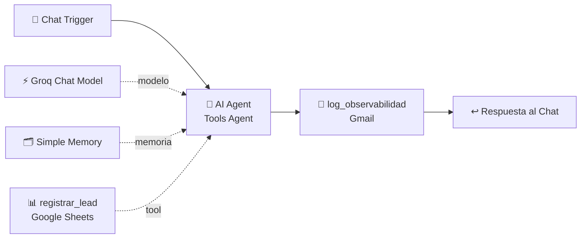

# 🤖 Agente de Calificación de Leads con IA — n8n

Proyecto integrador del curso avanzado de n8n (Coderhouse).
**Checkpoint 1:** Agente base y motor de razonamiento.

Este proyecto es un agente conversacional que atiende a potenciales clientes de **NexoDigital**, una agencia ficticia de automatización e IA para pymes. Conversa con el lead, obtiene sus datos, califica la oportunidad comercial (CALIENTE / TIBIO / FRÍO / ESCALAR) y la registra de forma autónoma en un CRM en Google Sheets. Además, envía un reporte de observabilidad por email en cada interacción.

---

## 📐 Arquitectura del flujo



| Nodo | Rol |
|---|---|
| **When chat message received** | Disparador que recibe el mensaje desestructurado del usuario. |
| **AI Agent (Tools Agent)** | Motor de razonamiento (ciclo ReAct): decide si responde o usa una herramienta. |
| **Groq Chat Model** | Modelo de lenguaje conectado de forma nativa. |
| **Simple Memory** | Recuerda los últimos 10 mensajes de cada sesión (por `sessionId`). |
| **registrar_lead** | Herramienta lateral (Google Sheets → append) que guarda el lead en el CRM. |
| **log_observabilidad** | Envía por Gmail el mensaje, la respuesta y el *Execution Log* (herramientas usadas, entradas y resultados). |
| **Respuesta al Chat** | Devuelve la respuesta final del agente al chat. |

---

## ✅ Requisitos del Checkpoint 1

- **Trigger:** Chat Trigger con `responseMode: lastNode`.
- **AI Agent en modo Tools Agent**, conectado a un Chat Model nativo.
- **Guardrail de iteraciones:** `maxIterations = 5`, dentro del rango exigido de 5 a 10, para evitar bucles infinitos y proteger el presupuesto.
- **System Prompt modular:** Rol → Ámbito → Objetivo → Reglas y restricciones → Escalamiento. Incluye límites explícitos de lo que el agente **no** puede hacer: no cotiza, no inventa datos, no agenda, no duplica registros y no responde temas fuera de ámbito. Está redactado sin lenguaje inclusivo.
- **Tool lateral** conectada al puerto `ai_tool`, nunca en la secuencia principal. Tiene una descripción semántica extensa que indica cuándo activarla, cuándo no y cómo completar cada campo, para mitigar la "instrucción huérfana".
- **Campos dinámicos con `$fromAI()`:** el modelo completa cada columna del CRM a partir de la conversación.
- **Observabilidad:** un nodo Gmail final que reporta el Execution Log (`returnIntermediateSteps`).
- **Prueba de funcionamiento:** el flujo ejecutado en verde, con la herramienta activada de forma autónoma.

---

## 🧠 Sobre el modelo

La consigna sugiere OpenAI (GPT-4o) o Anthropic (Claude). Para este checkpoint usé **Groq (`openai/gpt-oss-120b`)** porque ofrece un plan gratuito con buen soporte de herramientas.

El nodo de modelo es **intercambiable**: se puede reemplazar por *OpenAI Chat Model* o *Anthropic Chat Model* sin modificar el resto del flujo, porque el agente, el prompt, la herramienta y el log no dependen del proveedor.

---

## 🚀 Cómo usarlo

### 1. Importar
En n8n, ir a **Workflows → Import from File** y elegir `checkpoint1_valentin_turco.json`.

### 2. Credenciales
| Nodo | Credencial |
|---|---|
| Groq Chat Model | API key de [console.groq.com](https://console.groq.com) |
| registrar_lead | Google Sheets OAuth2 |
| log_observabilidad | Gmail OAuth2 |

> El JSON exportado **no contiene credenciales**, solo referencias por nombre.

### 3. Planilla CRM
Crear una Google Sheet con una pestaña llamada **`Leads`** y estos encabezados en la fila 1:

```
Fecha | Session_ID | Nombre | Email | Empresa | Necesidad | Presupuesto | Plazo | Calificacion | Resumen
```

Luego seleccionar la planilla en el nodo `registrar_lead` y el email de destino en `log_observabilidad`.

---

## 🧪 Casos de prueba

| # | Mensaje | Resultado esperado |
|---|---|---|
| 1 | *"Hola, soy Martín Gómez de Ferretería Sur, martin@ferreteriasur.com. Quiero un chatbot de WhatsApp para responder consultas de stock, tengo unos USD 2.000 y lo necesito en 1 mes."* | Usa `registrar_lead` → fila con calificación **CALIENTE** + mail de log. |
| 2 | *"¿Me ayudás con la tarea de matemática?"* | No usa herramientas, redirige amablemente al ámbito comercial. |
| 3 | *"Soy Laura Pérez, laura@test.com, quiero hablar con una persona, tengo un reclamo."* | Registra el lead con calificación **ESCALAR** y anuncia la derivación a un humano. |
| 4 | Datos enviados de a uno en varios mensajes | Gracias a la memoria, junta los datos y registra el lead al final. |

### Criterios de calificación
- **CALIENTE:** necesidad clara + presupuesto mayor a USD 1.000 + plazo menor a 3 meses.
- **TIBIO:** necesidad clara, pero presupuesto o plazo indefinidos.
- **FRÍO:** solo explora, sin necesidad concreta.
- **ESCALAR:** pide un humano, hace un reclamo o plantea una consulta técnica o legal compleja.

---

## 🔒 Seguridad

- Las API keys y los secretos OAuth se guardan cifrados en n8n y **no se versionan**.
- La herramienta solo **agrega** filas: el agente no puede leer, editar ni borrar datos existentes.
- El log se envía únicamente a un email interno de supervisión.
- Las pruebas se hicieron con datos ficticios.

---

## 🗺️ Hoja de ruta del proyecto integrador

| Módulo | Evolución |
|---|---|
| **M1** ✅ | Agente base: Trigger + AI Agent + System Prompt + Tool + Log |
| M2 | Multi-agente: Manager + Workers como sub-workflows |
| M3 | Memoria persistente en Airtable por `Session_ID` |
| M4 | Integraciones vía OAuth2: CRM, Google Calendar para agendar reuniones |
| M5 | RAG: base documental de servicios y casos de éxito (LlamaCloud) |
| M6 | Voz: STT / TTS |
| M11 | Proyecto Final Integrador |

---

**Autor:** Valentín Turco
